<!-- 1. 翔子透明立绘：优雅居中呈现，透气感与视觉锚点 -->

<h2 align="center" style="letter-spacing: 2px; font-weight: 600; color: #0f172a; margin-top: 10px;">
  MAKINOHARA SHOKO
</h2>

<!-- 2. 浅色同色系极简动态打字机（匹配立绘发色的深天青色 #0284C7） -->

<!-- 3. 几何标尺微线稿 -->

  

<!-- 4. 纯几何、同色系低饱和度线构卡片（自研 SVG：等轴测体素、有向拓扑环、长宽视框、正弦波形） -->

---

### 💭 随笔与信条 / Monologue

> *"在三维体素中构筑规则，在算法与信号中探寻逻辑，在长篇叙事与声音中安放情绪。"*

- **创造与探索**：热衷于从底层编写 Minecraft 模组与搭建自主 Agent，享受把抽象的规则具象化为运行系统的过程。
- **秩序与温度**：理性交付给架构、编译器与 DSP 信号；感性留给 Galgame 里的字句与耳机里流淌的旋律。

---

  ✦ Pure Geometry · Monochromatic Tone · Crafted for Makinohara Shoko

